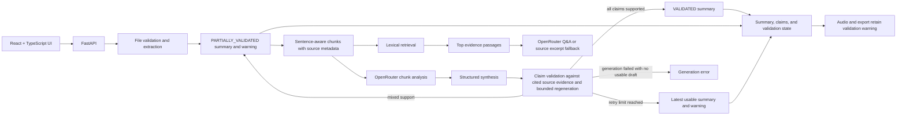

# Architecture

The current build is a local demo vertical slice. It uses OpenRouter through the OpenAI-compatible chat completions interface, in-memory document metadata, and lexical retrieval. OCR, durable persistence, semantic embeddings, reranking, asynchronous job queues, and database migrations remain future implementation work and are not represented as complete.

## Data flow and safety invariants

1. Upload extension is checked, data is limited to 25 MiB, and extraction is format-specific.
2. Chunks retain a stable ID, detected language, section placeholder, and PDF page where available.
3. OpenRouter gets bounded chunk groups, then synthesizes a structured summary with chunk IDs. A validator checks each claim against its cited source passages. For cross-language output, it compares the claim language with the source language semantically; the languages need not match. Regeneration and validation attempts are bounded.
4. Validation is a quality-control layer. If some or all claims remain unsupported when attempts end, the latest usable generated summary is returned with an explicit partial or retry-exhausted state, a warning, and claim-level statuses. Unsupported claims are never marked as validated. A generation error is returned only when no usable summary exists.
5. Q&A retrieves lexical evidence first, then sends only those passages with the question to OpenRouter. When generation fails, the UI gets source excerpts.
6. Audio and exports may use a usable partially validated summary, and carry its warning into the relevant UI or exported document. The audio view does not label it fully validated.
7. When a capability is missing (OCR, semantic retrieval, translation, evaluation), the API reports it as unavailable instead of claiming success.

## Production evolution

Replace in-memory `DOCS` with PostgreSQL entities for documents, versions, chunks, processing jobs, summaries, claims, validations, audio, and feedback. Store file binaries outside the relational database. Move extraction and analysis into a queue worker. Introduce provider protocols and circuit breakers around model, embedding, OCR, and TTS calls. Add multilingual embeddings and reranking, then evaluate each component against a versioned benchmark before enabling it.
