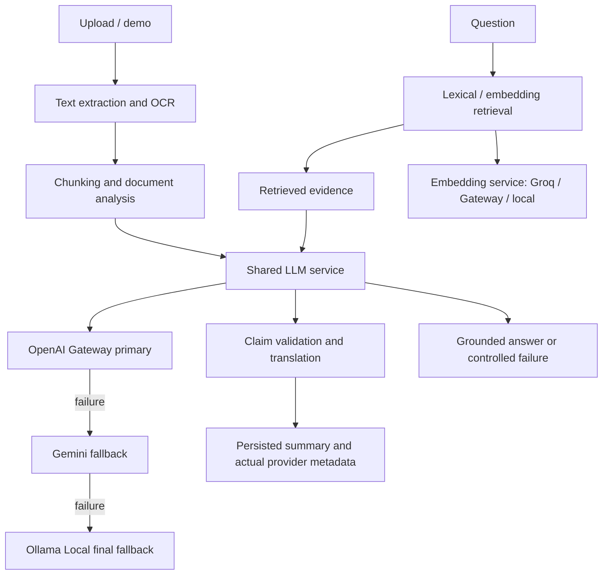

# Scribe architecture

All general-purpose generative operations use `backend/app/llm_service.py` and the strict OpenAI Gateway -> Gemini -> Ollama Local provider chain. The embedding subsystem is separate and may use its own configured services. Speech-to-text is a separate specialized service. Summary generation retains a deterministic extractive fallback after all three providers fail, while RAG does not expose retrieved excerpts as an answer when generation fails.
