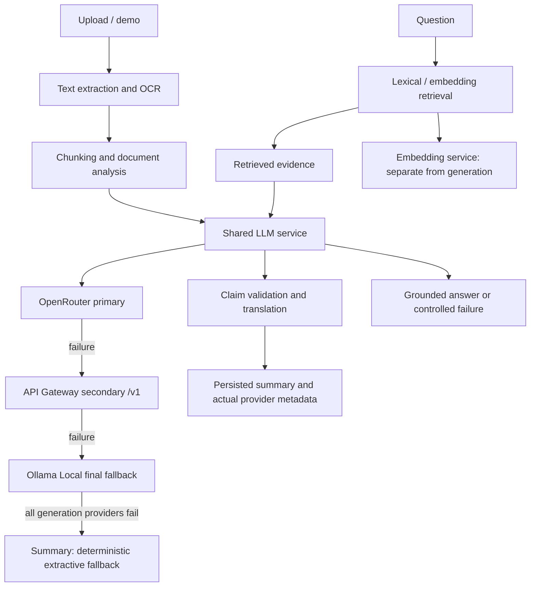

# Scribe architecture

All general-purpose generation uses `backend/app/llm_service.py` and the strict OpenRouter ? API Gateway ? Ollama Local chain. The embedding subsystem is separate. Speech-to-text is a specialized service. Summary generation retains the deterministic extractive fallback after all three LLM providers fail, while RAG returns a controlled failure instead of presenting retrieved excerpts as an answer.
